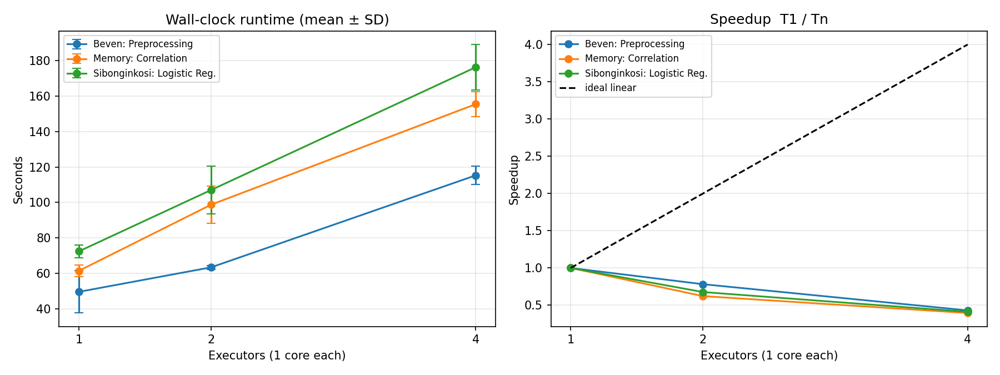
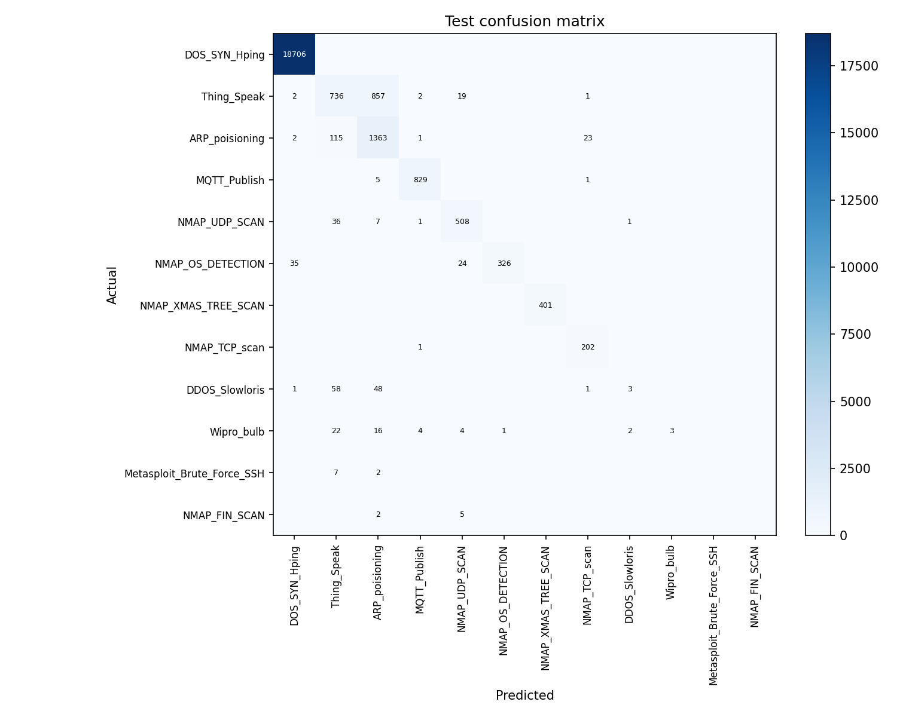
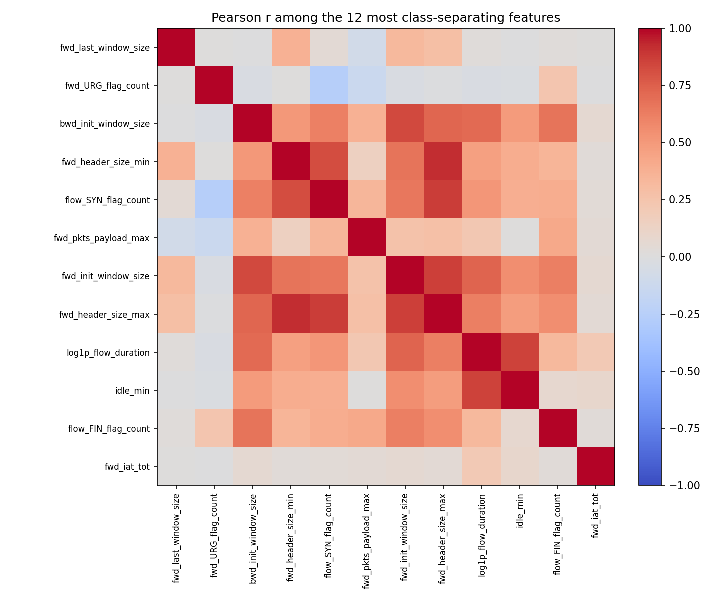

# Project Report: Distributed IoT Intrusion Detection and Network Traffic Analytics

**Team:** Beven Mpofu, Memory Mhembere, Sibonginkosi T Nkashe  
**Code:** [notebooks/spark_iot_project.ipynb](notebooks/spark_iot_project.ipynb)  
**Dataset:** RT-IoT2022, 123,117 flows, 85 attributes  
**Proposal:** [docs/project-proposal.pdf](docs/project-proposal.pdf)

## GitHub repository

https://github.com/bmpofu-create/distributed-iot-intrusion-detection

The notebook, this report, the proposal, the dataset, and the saved figures are in that repository.

## Code, method, and performance

The submitted code is one notebook. It follows the proposal: one PySpark standalone cluster, three member scripts, and a timing harness around each script. The three scripts are not timed as one combined pipeline. `timed_run` starts the clock, calls one member’s function, and stops the clock. Cluster startup and the Python warm-up sit outside that clock. Each function reads `RT_IOT2022.csv` itself, so the wall-clock time is that member’s whole script.

### What each script does

**Beven Mpofu — preprocessing.** `run_preprocessing` loads the CSV, renames dotted column names, casts types, drops the row index `no` and the constant column `bwd_URG_flag_count`, rewrites Zeek’s `service = "-"` to `unknown`, and keeps duplicate flows (they are repeated measurements, mostly the SYN flood). It then builds `total_pkts`, `total_payload`, `bytes_per_pkt`, `flag_events`, `log1p_flow_duration`, and `log1p_flow_pkts_per_sec`. A Spark ML pipeline indexes `Attack_type`, one-hot encodes `proto` and `service` (`StringIndexer`, `OneHotEncoder` with `handleInvalid="keep"`), assembles the numeric columns (`VectorAssembler`), and scales them (`StandardScaler`). Ports stay numeric because one-hot encoding them would explode the width. Extreme rates are not clipped: a packet rate near \(2 \times 10^6\) is the `DOS_SYN_Hping` attack, not a sensor error. The run kept all **123,117** rows and assembled a **103**-wide feature vector.

**Memory Mhembere — statistics.** `run_statistics` uses the same clean frame, then `groupBy("Attack_type")` for means and standard deviations of the profile columns, and `groupBy("proto", "service")` for the traffic mix. `Correlation.corr(..., "pearson")` builds the pairwise matrix on every numeric column with a positive standard deviation. Features are ranked by the spread of class means divided by the column’s overall standard deviation. The label is not entered into that matrix, because the class index is an arbitrary code.

**Sibonginkosi T Nkashe — classification.** `run_classification` fits the same feature pipeline on the training fold only, then fits multinomial `LogisticRegression` (`family="multinomial"`, `maxIter=50`, `regParam=0.01`, `elasticNetParam=0`, `standardization=False` because the numeric block is already scaled). The split is `randomSplit([0.8, 0.2], seed=42)`: **98,734** train rows and **24,383** test rows. `MulticlassClassificationEvaluator` reports accuracy, weighted precision, weighted recall, and weighted F1. Per-class precision, recall, and F1 come from the confusion matrix so the 77% `DOS_SYN_Hping` share cannot hide a model that misses the rare scans. The baseline is “always predict the majority training class.”

Spark is used for the distributed work, not only for a local `toPandas` conversion. The session sets `spark.executor.cores=1`, `spark.cores.max` to the executor count under test, 8 shuffle partitions, and adaptive query execution off, so the only change between trials is the number of executors.

### Model performance

| Metric | Value |
| --- | ---: |
| Majority class | DOS_SYN_Hping |
| Majority-class baseline accuracy | 0.7672 |
| Accuracy | 0.9464 |
| Weighted precision | 0.9506 |
| Weighted recall | 0.9464 |
| Weighted F1 | 0.9420 |
| Macro F1 | 0.6001 |

Accuracy is 17.9 percentage points above the baseline. Weighted F1 stays near accuracy because the test set has the same imbalance as the file. Macro F1, which treats all 12 classes equally, is the honest detection number: **0.60**.

| Class | Role | Precision | Recall | F1 | Test rows |
| --- | --- | ---: | ---: | ---: | ---: |
| DOS_SYN_Hping | attack | 0.998 | 1.000 | 0.999 | 18,706 |
| NMAP_XMAS_TREE_SCAN | attack | 1.000 | 1.000 | 1.000 | 401 |
| MQTT_Publish | benign | 0.989 | 0.993 | 0.991 | 835 |
| NMAP_TCP_scan | attack | 0.886 | 0.995 | 0.937 | 203 |
| NMAP_OS_DETECTION | attack | 0.997 | 0.847 | 0.916 | 385 |
| NMAP_UDP_SCAN | attack | 0.907 | 0.919 | 0.913 | 553 |
| ARP_poisioning | attack | 0.593 | 0.906 | 0.717 | 1,504 |
| Thing_Speak | benign | 0.756 | 0.455 | 0.568 | 1,617 |
| Wipro_bulb | benign | 1.000 | 0.058 | 0.109 | 52 |
| DDOS_Slowloris | attack | 0.500 | 0.027 | 0.051 | 111 |
| Metasploit_Brute_Force_SSH | attack | 0.000 | 0.000 | 0.000 | 9 |
| NMAP_FIN_SCAN | attack | 0.000 | 0.000 | 0.000 | 7 |

`DOS_SYN_Hping` is 18,706 of 18,706 on the test fold, and `NMAP_XMAS_TREE_SCAN` is 401 of 401. `Thing_Speak` is the large benign miss: 736 correct and 857 predicted as `ARP_poisioning` (the file’s spelling). `DDOS_Slowloris` has 3 of 111 correct. The two smallest classes have no true positives. The linear model has learned the dominant SYN flood and the sharp scan signatures. It has not separated the longer, lower-rate classes, and it has no class weights, so the loss is dominated by the majority label.

`DOS_SYN_Hping` is 94,659 flows (76.89%). Benign profiles in the file are `Thing_Speak`, `MQTT_Publish`, and `Wipro_bulb`. The strongest class-separating features are window sizes and flag counts (`fwd_last_window_size`, `fwd_URG_flag_count`, `bwd_init_window_size`, `flow_SYN_flag_count`), not raw byte totals. Several Pearson coefficients of 1.0 are engineered identities (`total_payload` is the sum of the directional payloads; `flow_duration` matches `flow_iat_tot`), so they are not independent discoveries.

## Screenshots of program results

These are the figures the notebook writes to `outputs/figures/` at the end of the timing, statistics, and classification sections.

**Runtime and speedup at 1, 2, and 4 executors.** Error bars are the standard deviation of three repeats. The dashed line is ideal linear speedup.

**Test confusion matrix** for the 12-class logistic regression.

**Pearson correlation** among the 12 features whose class means diverge the most.

## Performance comparison

### Configurations

Each member’s script was run with **1, 2, and 4 executors, 1 core each** (`spark.executor.cores=1`, `spark.cores.max` set to 1, 2, or 4). Executor memory was 512 MB plus 256 MB overhead. The worker advertises 4 cores so a session can request 4 executors. Partition count was fixed at **8**, and adaptive query execution was off, so executor count is the only change between trials.

### Repeats and wall-clock time

Each configuration was repeated **3 times** (3 scripts × 3 executor counts × 3 repeats = 27 timed jobs). The table below is the **mean ± standard deviation** of wall-clock seconds. The clock covers one member’s entire script, including that script’s CSV read. It does not cover the other members’ scripts, and it does not cover cluster startup.

In `outputs/iot_raw_timings.csv`, `executors_seen` equals the number requested on all 27 jobs.

### Runtime hardware and partitions

Recorded in `outputs/iot_hardware.json` on the machine that produced these times:

| Item | Value |
| --- | --- |
| `os.cpu_count()` | 2 |
| RAM | 13.61 GB |
| Partitions | 8 (fixed for every trial) |
| Cores per executor | 1 |
| Repeats | 3 |
| Data | 123,117 rows, about 52 MB |

### Mean ± SD, speedup, and the team table

Speedup is \(T_1 / T_n\): the 1-executor mean divided by the mean at \(n\) executors. Efficiency is speedup divided by \(n\).

| Member and method | 1 executor | 2 executors | 4 executors | Speedup at 2 | Speedup at 4 | Efficiency at 4 |
| --- | ---: | ---: | ---: | ---: | ---: | ---: |
| Beven Mpofu: preprocessing | 49.60 ± 11.94 s | 63.42 ± 1.12 s | 115.28 ± 5.15 s | 0.782 | 0.430 | 0.108 |
| Memory Mhembere: correlation | 61.44 ± 3.25 s | 98.75 ± 10.47 s | 155.42 ± 6.96 s | 0.622 | 0.395 | 0.099 |
| Sibonginkosi T Nkashe: logistic regression | 72.42 ± 3.67 s | 107.03 ± 13.57 s | 176.24 ± 12.79 s | 0.677 | 0.411 | 0.103 |

The same comparison is the figure in the screenshots section (`outputs/figures/iot_scaling.png`): runtime with mean ± SD on the left, speedup against the ideal line on the right.

Preprocessing at 1 executor has a wide spread because the first repeat took 63.3 s and the next two took 41.3 s and 44.3 s. That high first sample raises \(T_1\). A lower \(T_1\) would make the speedup smaller. The conclusion does not depend on that outlier: every later repeat is still faster than the 2-executor and 4-executor means.

### Why speedup does not scale

No script speeds up. At 4 executors every speedup is about 0.40.

**Available cores.** `os.cpu_count()` is 2. Two executors, plus the driver, already fill the machine. Four executors ask for twice as many cores as the host has, so those executors take turns on the same two CPUs. Wall-clock time rises because the job waits on the CPU, not because Spark failed to launch the executors.

**Shuffle overhead.** Every script repartitions the CSV to 8 partitions. Correlation then shuffles on `groupBy` and on `Correlation.corr`, which exchanges a wide numeric vector to build the covariance. Logistic regression shuffles again on `randomSplit` and inside the feature pipeline. Those exchanges cost more as executors are added, and the result has to be collected back to the driver for the Pearson matrix and the confusion matrix.

**Scheduling overhead.** Each trial builds a new `SparkSession`, launches tasks for 8 partitions, and tears the session down. With 4 executors that is about two tasks per executor, so the scheduler’s per-task cost is a large fraction of a job this small. That fixed cost is inside the clock, and it does not shrink when more executors are added.

**Data size.** The file is 123,117 rows and about 52 MB. Spark’s startup, shuffle, and task-launch cost is larger than the compute in each partition. There is not enough data for extra executors to pay for themselves. A larger capture, on a host with at least four physical cores, would be required before a speedup above 1 could be expected.

### Which method scales better, and why

None of the three methods scales in the sense of speedup greater than 1. “Better” here means the speedup falls off more slowly.

**Preprocessing scales least badly.** Speedup is 0.782 at 2 executors and 0.430 at 4. A large share of that script is reading the CSV, indexing, and assembling a wide vector. Those stages move data, but they do less of the all-pairs shuffle that correlation does, so the second executor hurts preprocessing less than it hurts the other two scripts.

**Correlation scales the worst.** Speedup is 0.622 at 2 executors and 0.395 at 4, and it is the steepest drop at 2 executors. `Correlation.corr` and the grouped aggregations are shuffle-heavy: every numeric column participates in one covariance. Adding executors adds shuffle partners faster than it adds useful CPU, and this host has no spare core to absorb that exchange.

**Logistic regression is the slowest script at every width** (72 s, 107 s, 176 s) because it does the most CPU work per row: a 50-iteration multinomial fit on 103 features. Its speedup (0.677 at 2 executors, 0.411 at 4) sits between the other two. Extra CPU work is exactly what a second core could help, but the machine’s second core is already busy, and the 80/20 split plus the feature pipeline still shuffle. The iterative fit therefore cannot pull ahead of the I/O-bound scripts.

At 4 executors the three speedups collapse together (0.430, 0.411, 0.395). Past two executors the differences in the algorithms stop mattering. All three are limited by the same two cores, the same 8 partitions, and the same small file.

## Dataset notes used by the scripts

| Attack_type | Flows | Share | Role |
| --- | ---: | ---: | --- |
| DOS_SYN_Hping | 94,659 | 76.89% | attack |
| Thing_Speak | 8,108 | 6.59% | benign |
| ARP_poisioning | 7,750 | 6.29% | attack |
| MQTT_Publish | 4,146 | 3.37% | benign |
| NMAP_UDP_SCAN | 2,590 | 2.10% | attack |
| NMAP_XMAS_TREE_SCAN | 2,010 | 1.63% | attack |
| NMAP_OS_DETECTION | 2,000 | 1.62% | attack |
| NMAP_TCP_scan | 1,002 | 0.81% | attack |
| DDOS_Slowloris | 534 | 0.43% | attack |
| Wipro_bulb | 253 | 0.21% | benign |
| Metasploit_Brute_Force_SSH | 37 | 0.03% | attack |
| NMAP_FIN_SCAN | 28 | 0.02% | attack |

Source file: [Kaggle, RT-IoT2022](https://www.kaggle.com/datasets/supplejade/rt-iot2022real-time-internet-of-things). No synthetic resampling. Saved tables are under `outputs/`.
